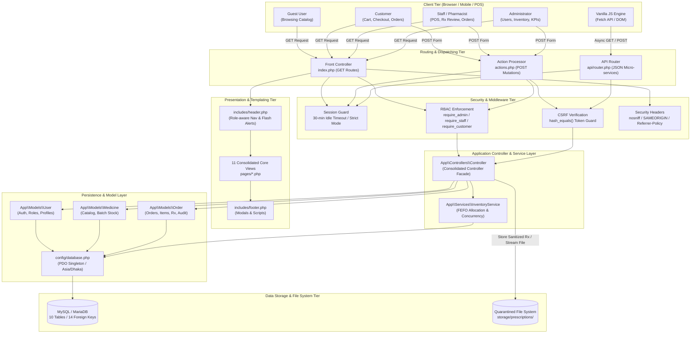
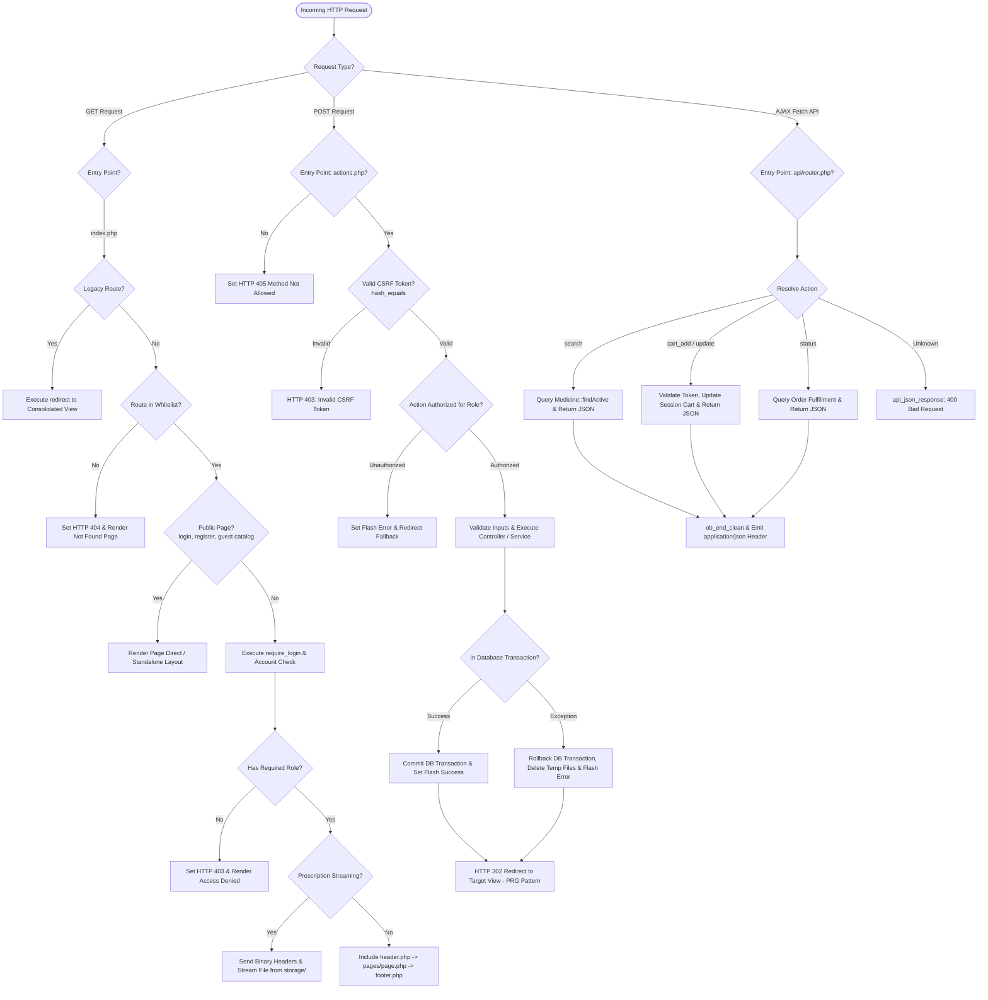
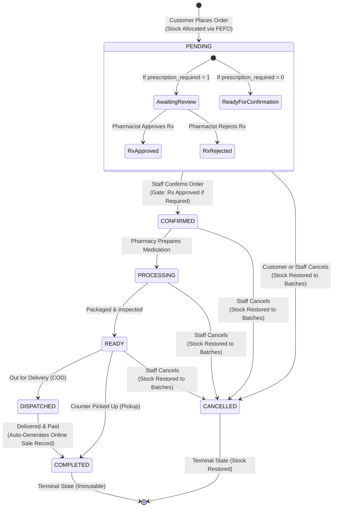

# PharmaCare — Technical System Architecture Document

**Academic Course:** CIS324 Web Engineering — Topic 13: Pharmacy Management System  
**System Name:** PharmaCare Complete Pharmacy Management & E-Commerce Web Application  
**Version:** 2.0.0 (Production-Grade Architectural Consolidation)  
**Document Classification:** Internal Technical Architecture & Engineering Specification  
**Technology Stack:** PHP 8.1+, MySQL 8.0 / MariaDB 10.4+, Vanilla JavaScript (Fetch API, DOM), HTML5, CSS3 / Bootstrap 5  
**Document Generated:** November 2026  
**Status:** Complete, Formally Audited, and Verified Against Codebase  

---

## Table of Contents

1. [Executive Summary & Architectural Paradigm](#1-executive-summary--architectural-paradigm)
2. [Project File Structure & Component Topology](#2-project-file-structure--component-topology)
3. [Mermaid System Architecture & Workflow Diagrams](#3-mermaid-system-architecture--workflow-diagrams)
   - [3.1 High-Level Layered System Architecture](#31-high-level-layered-system-architecture)
   - [3.2 Request-Response Lifecycle Flowchart](#32-request-response-lifecycle-flowchart)
   - [3.3 Order Fulfillment & Prescription State Machine](#33-order-fulfillment--prescription-state-machine)
4. [Component Roles & Responsibilities (MVC Deep Dive)](#4-component-roles--responsibilities-mvc-deep-dive)
   - [4.1 Front Controller (`index.php`)](#41-front-controller-indexphp)
   - [4.2 Centralized Action Processor (`actions.php`)](#42-centralized-action-processor-actionsphp)
   - [4.3 Asynchronous API Router (`api/router.php`)](#43-asynchronous-api-router-apirouterphp)
   - [4.4 Application Controller & Service Facade (`app/Controller.php`)](#44-application-controller--service-facade-appcontrollerphp)
   - [4.5 Domain Models (`app/Model.php`)](#45-domain-models-appmodelphp)
   - [4.6 Inventory & Concurrency Service (`app/InventoryService.php`)](#46-inventory--concurrency-service-appinventoryservicephp)
   - [4.7 Consolidated Views & Layout Templating (`pages/*.php`, `includes/`)](#47-consolidated-views--layout-templating-pagesphp-includes)
5. [Request-Response Lifecycles](#5-request-response-lifecycles)
   - [5.1 Synchronous Page View (GET Request)](#51-synchronous-page-view-get-request)
   - [5.2 Synchronous State Mutation (POST Request via PRG Pattern)](#52-synchronous-state-mutation-post-request-via-prg-pattern)
   - [5.3 Asynchronous JSON API Request (Client-Side Fetch API)](#53-asynchronous-json-api-request-client-side-fetch-api)
6. [Security Architecture & Defensive Engineering](#6-security-architecture--defensive-engineering)
   - [6.1 Session Management & Hardening](#61-session-management--hardening)
   - [6.2 Authentication & Credential Security](#62-authentication--credential-security)
   - [6.3 Role-Based Access Control (RBAC) Matrix](#63-role-based-access-control-rbac-matrix)
   - [6.4 Cross-Site Request Forgery (CSRF) Defense](#64-cross-site-request-forgery-csrf-defense)
   - [6.5 Cross-Site Scripting (XSS) Prevention & Output Encoding](#65-cross-site-scripting-xss-prevention--output-encoding)
   - [6.6 SQL Injection Prevention & Prepared Statements](#66-sql-injection-prevention--prepared-statements)
   - [6.7 Insecure Direct Object References (IDOR) Protection](#67-insecure-direct-object-references-idor-protection)
   - [6.8 Secure File Upload & Prescription Quarantine](#68-secure-file-upload--prescription-quarantine)
7. [Database Architecture & Relational Persistence](#7-database-architecture--relational-persistence)
   - [7.1 Database Connection & Singleton Pattern](#71-database-connection--singleton-pattern)
   - [7.2 Relational Schema & Table Definitions](#72-relational-schema--table-definitions)
   - [7.3 Foreign Key Referential Actions & Cascades](#73-foreign-key-referential-actions--cascades)
   - [7.4 Integrity Constraints & Business Invariants](#74-integrity-constraints--business-invariants)
   - [7.5 Historical Snapshotting Pattern](#75-historical-snapshotting-pattern)
   - [7.6 Concurrency Control & Pessimistic Row Locking](#76-concurrency-control--pessimistic-row-locking)
8. [Core Business Workflows](#8-core-business-workflows)
   - [8.1 Workflow 1: User Registration & Authentication](#81-workflow-1-user-registration--authentication)
   - [8.2 Workflow 2: Medicine Inventory Management & FEFO Allocation](#82-workflow-2-medicine-inventory-management--fefo-allocation)
   - [8.3 Workflow 3: Live Catalog Search & Asynchronous Client Filtering](#83-workflow-3-live-catalog-search--asynchronous-client-filtering)
   - [8.4 Workflow 4: Shopping Cart Management & Stock Clamping](#84-workflow-4-shopping-cart-management--stock-clamping)
   - [8.5 Workflow 5: Checkout & Transaction-Safe Order Placement](#85-workflow-5-checkout--transaction-safe-order-placement)
   - [8.6 Workflow 6: Order Fulfillment Lifecycle & Status Auditing](#86-workflow-6-order-fulfillment-lifecycle--status-auditing)
   - [8.7 Workflow 7: Prescription Review & Verification Gate](#87-workflow-7-prescription-review--verification-gate)
   - [8.8 Workflow 8: Point of Sale (POS) Counter Dispensing & Invoicing](#88-workflow-8-point-of-sale-pos-counter-dispensing--invoicing)
9. [System Boundaries, Known Limitations & Technical Constraints](#9-system-boundaries-known-limitations--technical-constraints)
10. [Architecture Verification & Source Code Mapping](#10-architecture-verification--source-code-mapping)

---

## 1. Executive Summary & Architectural Paradigm

PharmaCare is an enterprise-grade, web-based Pharmacy Management and E-Commerce System engineered to fulfill the comprehensive clinical, retail, and regulatory requirements of a modern community or institutional pharmacy. The system bridges consumer e-commerce (online medicine catalog, digital shopping cart, prescription upload, and real-time delivery tracking) with internal pharmacy operations (batch-level inventory tracking, supplier management, POS counter dispensing, prescription verification, order fulfillment workflows, and executive analytics).

### Architectural Philosophy
The application implements a **Layered Model-View-Controller (MVC)** design pattern combined with a **Single Front Controller** routing paradigm, a **Centralized Action Processor**, and a dedicated **Service Layer**. This architectural consolidation balances clean code organization with zero external framework overhead, relying entirely on native PHP 8 features, modern PDO database abstraction, and standard web platform capabilities.

Key architectural characteristics include:
1. **Front Controller Pattern (`index.php`)**: All incoming synchronous page view requests funnel through a single entry point that manages session initialization, HTTP security headers, legacy route redirection, route whitelisting, and Role-Based Access Control (RBAC) guards before delegating rendering to core views.
2. **Centralized Form Action Processor (`actions.php`)**: All state-mutating HTTP POST requests are routed to a centralized controller that enforces mandatory CSRF verification, validates domain payloads, checks role authorizations, executes business operations within database transactions, and responds via the Post/Redirect/Get (PRG) pattern with contextual flash messaging.
3. **Decoupled Asynchronous API Router (`api/router.php`)**: A dedicated JSON-only endpoint exposes micro-actions for client-side interactions (asynchronous catalog search, dynamic cart count updates, and live order tracking polling) using native Vanilla JavaScript `fetch()` calls.
4. **Service-Oriented Domain Layer (`app/InventoryService.php`, `app/Controller.php`)**: Critical business rules—such as First-Expired-First-Out (FEFO) batch allocation, pessimistic row locking (`SELECT ... FOR UPDATE`), stock restoration idempotency, and prescription file sanitization—are encapsulated within service methods rather than embedded in presentation templates or raw queries.
5. **Defense-in-Depth Security**: The system incorporates session hardening (strict mode, HTTP-only, SameSite=Lax, 30-minute idle inactivity timeout), cryptographic CSRF tokens, strict parameterized prepared queries, XSS contextual escaping, and secure non-executable file quarantine for patient prescription documents.

---

## 2. Project File Structure & Component Topology

The repository follows a clean, modular structure where presentation, domain logic, configuration, storage, and database scripts are strictly isolated.

```text
D:\PharmaCare-PHP-Complete\PharmaCare-PHP\
│
├── index.php                      # Single Front Controller for synchronous GET page routing & RBAC
├── actions.php                    # Centralized Action Processor for POST mutations & PRG redirects
├── .htaccess                      # Apache web server configuration (disallows directory browsing)
├── README.md                      # Academic project documentation & installation instructions
├── LICENSE                        # Open source MIT license declaration
│
├── api/                           # Asynchronous RESTful JSON API Subsystem
│   └── router.php                 # Single JSON API router handling search, cart, and live status
│
├── app/                           # Core Domain & Application Layer (Namespaced: App\)
│   ├── Controller.php             # Unified Controller & Service Facade (App\Controllers\Controller)
│   ├── Model.php                  # Active Record / Query Model Layer (User, Medicine, Order)
│   └── InventoryService.php       # FEFO stock allocation & pessimistic concurrency locking service
│
├── config/                        # Environment & Infrastructure Configuration
│   └── database.php               # PDO singleton database connection & environment variables
│
├── database/                      # Relational Database Definitions & Data Seeders
│   └── pharmacare.sql             # Complete DDL/DML: 10 tables, 14 foreign keys, sample seed data
│
├── includes/                      # Global Framework Bootstrap, Guards & Layout Partials
│   ├── auth.php                   # Authentication guards (require_login, require_admin, require_staff, timeout)
│   ├── functions.php              # Global bootstrap: session hardening, CSRF, escaping, flash, helpers
│   ├── header.php                 # Dynamic navigation layout, role-based nav items, flash alert banner
│   └── footer.php                 # Global HTML footer, script inclusions, modal containers
│
├── pages/                         # 11 Consolidated Core Views (Injected by index.php)
│   ├── login.php                  # Public user authentication interface
│   ├── register.php               # Customer self-registration form
│   ├── dashboard.php              # Admin/Staff executive KPI analytics & inventory alert console
│   ├── catalog.php                # Public / Customer medicine browsing catalog with live filtering
│   ├── cart.php                   # Shopping cart review & unified checkout delivery form
│   ├── orders.php                 # Order management table (Customer order history / Staff processing)
│   ├── order_detail.php           # Deep order timeline, FEFO line items, prescription review modal
│   ├── medicines.php              # Tabbed inventory management: medicines, categories, suppliers
│   ├── sales.php                  # Point of Sale (POS) counter dispensing interface & sales history
│   ├── invoice.php                # Formatted printable customer receipt / invoice view
│   └── users.php                  # Administrator-only user account management & password reset
│
├── assets/                        # Client-Side Static Assets
│   ├── script.js                  # Vanilla JavaScript: live search, AJAX cart, auto-dismiss alerts
│   └── style.css                  # Custom styling, print media rules, status badges, modern design tokens
│
├── storage/                       # Local Quarantined Storage (Non-public upload repository)
│   └── prescriptions/             # Quarantined prescription uploads (accessed strictly via streaming)
│       └── .gitkeep               # Directory placeholder
│
├── tests/                         # Automated Quality Assurance & Verification Suite
│   └── run_tests.php              # Comprehensive CLI test runner (Database preflight, RBAC, Cart, FEFO)
│
└── docs/                          # Architectural & Academic Documentation
    ├── PharmaCare_System_Architecture.md  # This comprehensive system architecture specification
    ├── ERD_Analysis_Report.md             # Detailed Entity Relationship relational audit
    ├── CIS324_Assignment_Report.md       # Comprehensive academic project report
    ├── PharmaCare_ER_Diagram.mmd          # Mermaid source file for database schema
    ├── PharmaCare_ER_Diagram.pdf          # Vector PDF entity-relationship diagram
    ├── PharmaCare_ER_Diagram.png          # High-resolution raster entity-relationship diagram
    └── screenshots/                       # Verified automated browser testing screenshots (14 pages)
```

---

## 3. Mermaid System Architecture & Workflow Diagrams

### 3.1 High-Level Layered System Architecture

The following diagram illustrates the complete layered architecture of PharmaCare, showing request dispatching, security guards, domain controllers, inventory services, persistence models, and database storage.



---

### 3.2 Request-Response Lifecycle Flowchart

The application strictly separates synchronous navigation, state-altering form submissions, and asynchronous micro-requests into three distinct execution paths.



---

### 3.3 Order Fulfillment & Prescription State Machine

Online orders progress through a deterministic, strictly regulated state machine. The order lifecycle enforces that any order containing prescription medications cannot proceed past `PENDING` until a verified pharmacist has reviewed and explicitly approved the uploaded prescription file.



---

## 4. Component Roles & Responsibilities (MVC Deep Dive)

PharmaCare implements a clean architectural division of responsibilities across the presentation, application, domain service, and persistence layers.

### 4.1 Front Controller (`index.php`)

The Front Controller acts as the single gateway for all synchronous web navigation within the system.

**Responsibilities:**
1. **Bootstrap Initialization:** Includes `includes/functions.php`, initializing session hardening, security headers, database singleton, and domain classes.
2. **Default Route Resolution:** Determines the requested page via `$_GET['page']`. If absent, defaults intelligently to `'catalog'` for authenticated customers, or `'dashboard'` for staff/administrators and unauthenticated visitors.
3. **Legacy Route Mapping:** Automatically intercepts legacy URLs (e.g., `checkout`, `my_orders`, `sale_form`, `medicine_form`) and cleanly redirects them to their consolidated view equivalents using HTTP redirects.
4. **Route Whitelisting:** Enforces a strict whitelist of 11 consolidated core views:
   ```php
   $routes = ['login', 'register', 'dashboard', 'catalog', 'cart', 'orders', 'order_detail', 'medicines', 'sales', 'invoice', 'users'];
   ```
   Any unknown route triggers an immediate HTTP 404 response wrapped in the application layout.
5. **Public Access Partitioning:** Bypasses authentication for `login`, `register`, and guest catalog browsing (`page=catalog`). Automatically redirects already-logged-in users attempting to access login/register to their appropriate homepage.
6. **Role-Based Access Control (RBAC):** Executes `require_login()` for all protected routes, followed by strict role guards:
   - `$adminOnlyPages = ['users']` -> `require_admin()`
   - `$staffOrAdminPages = ['dashboard', 'medicines', 'sales']` -> `require_staff_or_admin()`
   - `$customerOnlyPages = ['cart']` -> `require_customer()`
7. **Secure Binary Streaming Interception:** If `page=order_detail` is requested with streaming parameters (`view_rx`, `stream_rx`, or `download`), `index.php` delegates directly to the view script before outputting layout headers, allowing clean binary file streaming without HTML pollution.
8. **View Templating Wrap:** Wraps the resolved view script (`pages/{$page}.php`) between `includes/header.php` and `includes/footer.php`.

---

### 4.2 Centralized Action Processor (`actions.php`)

`actions.php` is the dedicated mutation engine of PharmaCare, handling all HTTP POST requests. It completely decouples state-changing domain operations from HTML rendering.

**Key Architectural Features:**
1. **HTTP Method Verification:** Rejects non-POST requests immediately with an `HTTP 405 Method Not Allowed`.
2. **Universal CSRF Verification:** Executes `csrf_verify()` before inspecting the requested action. Rejects missing or timing-mismatched tokens with an `HTTP 403 Forbidden`.
3. **Action Dispatching:** Reads `$_POST['action']` and routes execution through a structured switch statement covering 17 distinct operational actions:
   - **Authentication:** `login`, `register`, `logout`
   - **Customer Profile:** `profile_update`
   - **Cart Lifecycle:** `cart_add`, `cart_update`, `cart_remove`, `cart_clear`
   - **Order Lifecycle:** `order_create`, `order_update_status`, `order_cancel_customer`, `prescription_review`
   - **Inventory Master Data:** `category_save`, `category_delete`, `supplier_save`, `supplier_delete`, `medicine_save`, `medicine_toggle`
   - **User Administration:** `user_create`, `user_toggle`, `user_reset_password`
   - **POS Dispensing:** `sale_create`
4. **Pre-Execution RBAC Guarding:** Actions are grouped into authorization tiers (`$customerActions`, `$staffOrAdminActions`, `$adminActions`). Unauthorized role attempts are trapped before business logic executes.
5. **Post-Redirect-Get (PRG) Pattern:** Every action concludes with an explicit HTTP 302 redirect back to the originating page or fallback view. This prevents browser form re-submission warnings on page refresh.
6. **Unified Exception Handling:**
   - `DomainException`: Trapped and transformed into user-friendly error flash messages.
   - `PDOException`: Trapped, inspected for MySQL error codes (1062 duplicate key, 1451 foreign key restrict), and mapped to clean instructional messages without exposing database internals or queries.

---

### 4.3 Asynchronous API Router (`api/router.php`)

The API Router serves as the headless JSON endpoint powering modern client-side dynamic interfaces (Vanilla JS Fetch API).

**Endpoints & Capabilities:**
- `action=search` -> `Controller::searchApi()`: Live search filtering across medicine catalog by keyword and category. Returns JSON payload with medicine metadata, stock levels, dosage badges, and current cart quantities.
- `action=cart_add` -> `Controller::cartAddApi()`: Asynchronously adds items to session cart without full page reload.
- `action=cart_update` -> `Controller::cartUpdateApi()`: Modifies quantities or removes items asynchronously.
- `action=status` -> `Controller::orderStatusApi()`: Polls live order fulfillment status and timeline events for real-time order tracking.

**Standardized JSON Response Contract:**
All API responses follow a strict envelope:
```json
{
  "success": true,
  "message": "Medicines retrieved successfully.",
  "data": { }
}
```
The router cleans all active output buffers (`ob_end_clean()`), emits the `Content-Type: application/json; charset=UTF-8` and `X-Content-Type-Options: nosniff` headers, and outputs JSON with unescaped slashes and unicode characters.

---

### 4.4 Application Controller & Service Facade (`app/Controller.php`)

The `\App\Controllers\Controller` class encapsulates the application workflows, bridging HTTP input parsing, authorization checks, domain validation, and model persistence.

**Class Aliases for Clean Architecture:**
For maximum architectural backwards compatibility, `Controller.php` defines class aliases mapping specialized sub-controllers to the unified controller facade:
```php
class_alias(\App\Controllers\Controller::class, 'Controller');
class_alias(\App\Controllers\Controller::class, \App\Controller::class);
class_alias(\App\Controllers\Controller::class, 'App\Controllers\CatalogController');
class_alias(\App\Controllers\Controller::class, 'App\Controllers\CartController');
class_alias(\App\Controllers\Controller::class, 'App\Controllers\OrderController');
class_alias(\App\Controllers\Controller::class, 'App\Services\OrderService');
class_alias(\App\Controllers\Controller::class, 'App\Services\DashboardService');
```

**Core Controller Subsystems:**
1. **Catalog & Search:**
   - `catalog()`: Prepares category lists and active catalog items for the storefront view.
   - `searchApi()`: Returns structured JSON medicine objects with calculated dosage labels, stock badges, and pricing.
2. **Cart Management:**
   - `cartAdd()`, `cartUpdate()`, `cartRemove()`, `cartClear()`: Manages `$_SESSION['cart']` items, enforcing positive quantities and stock clamping.
   - `cartAddApi()`, `cartUpdateApi()`: Handles asynchronous cart manipulation with CSRF token verification.
3. **Order Lifecycle Domain Logic:**
   - `store()`: Customer order placement action handler.
   - `createOrder(array $input, array $cart, ?array $file)`: Static service method executing the complete order transaction (FEFO stock allocation, order insertion, line item snapshots, prescription upload, initial status history).
   - `updateOrderStatus(int $orderId, string $newStatus, ?string $remarks, ?int $actorId)`: State machine transition executor with stock restoration on cancellation and automatic sales invoice generation on completion.
   - `cancelOrderByCustomer(int $orderId, int $customerId, ?string $remarks)`: Allows customers to cancel their own `PENDING` orders.
   - `reviewPrescription(int $orderId, string $status, ?string $notes, ?int $reviewerId)`: Pharmacist verification decision handler.
   - `downloadPrescription()`: Secure streaming of quarantined prescription files with proper MIME types.
4. **Dashboard Analytics & KPIs:**
   - `getFinancialKpis()`: Calculates gross revenue, today's sales, this month's revenue, and total discount awarded.
   - `getInventoryKpis()`: Tracks total SKUs, active items, out-of-stock items, low stock warnings, and expired batches.
   - `getOperationsKpis()`: Counts pending orders, active processing orders, and prescriptions awaiting pharmacist review.
   - `getTopSellingMedicines(int $limit)`: Aggregates top-dispensed medications by sales volume.
   - `getRecentTransactions(int $limit)`: Fetches combined recent online orders and POS counter sales.

---

### 4.5 Domain Models (`app/Model.php`)

The model layer encapsulates SQL queries and data persistence operations using prepared statements.

**1. `\App\Models\User` (`User`):**
- `findById(int $id)`: Retrieves user record by primary key.
- `findByUsernameOrEmail(string $identifier)`: Fetches active account for authentication.
- `createCustomer(array $data)`: Inserts newly registered customer with Bcrypt password hashing.
- `updateProfile(int $id, array $data)`: Updates customer contact and shipping details.
- `existsByUsername(string $username, ?int $excludeId)`: Validates username uniqueness.
- `existsByEmail(string $email, ?int $excludeId)`: Validates email uniqueness.

**2. `\App\Models\Medicine` (`Medicine`):**
- `baseQuery()`: Standard multi-table query joining `categories` and `suppliers`.
- `findById(int $id)`: Retrieves single medicine batch.
- `findActive(string $keyword, int $categoryId)`: Queries active, unexpired medicines matching search filters.
- `lockBatchForUpdate(PDO $pdo, int $id)`: Acquires an exclusive row-level lock (`SELECT ... FOR UPDATE`) on a specific medicine batch.
- `decrementStock(PDO $pdo, int $id, int $quantity)`: Atomically decrements batch stock.
- `incrementStock(PDO $pdo, int $id, int $quantity)`: Atomically increments batch stock.
- `getAllCategories()`: Fetches all medicine classification categories.

**3. `\App\Models\Order` (`Order`):**
- `findById(int $id)`: Retrieves complete order details.
- `findByOrderNumber(string $orderNumber)`: Retrieves order by unique tracking reference.
- `findByCustomerId(int $customerId)`: Fetches personal order history for a customer.
- `findAll(?string $statusFilter)`: Queries all orders for staff administration.
- `getItems(int $orderId)`: Retrieves order line item snapshots.
- `getPrescription(int $orderId)`: Retrieves attached prescription metadata.
- `getHistory(int $orderId)`: Retrieves audit log trail from `order_status_history`.
- `create(PDO $pdo, array $data)`: Inserts new order master record.
- `addItems(PDO $pdo, int $orderId, array $items)`: Inserts snapshot line items.
- `addPrescription(PDO $pdo, int $orderId, int $customerId, array $fileData)`: Records prescription file metadata.
- `addStatusHistory(PDO $pdo, int $orderId, ?string $oldStatus, string $newStatus, ?int $changedById, ?string $remarks)`: Appends immutable audit log entry.
- `updateStatus(PDO $pdo, int $orderId, string $status)`: Updates current status in `orders`.
- `markPaymentStatus(PDO $pdo, int $orderId, string $paymentStatus)`: Updates payment status.
- `markStockRestored(PDO $pdo, int $orderId)`: Sets `stock_restored = 1` preventing double-restoration.
- `updatePrescriptionStatus(PDO $pdo, int $orderId, string $status, ?int $reviewerId, ?string $notes)`: Records pharmacist decision.

---

### 4.6 Inventory & Concurrency Service (`app/InventoryService.php`)

`InventoryService` contains the pharmaceutical stock management algorithms, ensuring zero race conditions, eliminating double-deductions, and strictly enforcing the **First-Expired-First-Out (FEFO)** dispensing rule.

**Key Algorithms:**
1. **`allocateFefoStock(PDO $pdo, int $medicineId, int $requestedQuantity): array`**
   - Retrieves the target medicine name, generic formulation, and dosage form.
   - Queries all unexpired, active batches sharing the formulation or ID, ordered strictly by `expiry_date ASC, id ASC`.
   - Acquires pessimistic row locks (`FOR UPDATE`) on matching batches.
   - Iterates through batches, deducting available units via `deductBatchStock()` until the requested quantity is satisfied.
   - Throws a `DomainException` if aggregate available stock across all unexpired batches is insufficient.
   - Returns an array of batch allocation records (batch ID, batch number, unit price, quantity deducted) used to populate order items.
2. **`deductBatchStock(PDO $pdo, int $batchId, int $quantity): array`**
   - Locks the specific medicine row (`FOR UPDATE`).
   - Verifies the medicine exists, is active (`active = 1`), and has not passed its expiration date (`expiry_date >= CURDATE()`).
   - Asserts that current stock is sufficient (`quantity >= requested`).
   - Executes atomic decrement: `UPDATE medicines SET quantity = quantity - ? WHERE id = ?`.
   - Returns the updated batch state with verification assertions.
3. **`restoreBatchStock(PDO $pdo, int $batchId, int $quantity): int`**
   - Locks the medicine row (`FOR UPDATE`).
   - Atomically restores deducted stock: `UPDATE medicines SET quantity = quantity + ? WHERE id = ?`.
   - Called exclusively during order cancellation.

---

### 4.7 Consolidated Views & Layout Templating (`pages/*.php`, `includes/`)

The view layer utilizes standard PHP templating wrapped in layout partials.

- **`includes/header.php`:** Outputs HTML5 doctype, CSS links (`assets/style.css`, Bootstrap 5), dynamic navigation bar based on user authentication state and role (`ADMIN`, `STAFF`, `CUSTOMER`), dynamic cart item badge, and renders session flash message alerts.
- **`includes/footer.php`:** Closes HTML structure, renders shared modal dialogs, and loads `assets/script.js` and Bootstrap bundle.
- **11 Consolidated Core Views:**
  1. `pages/login.php`: Public authentication view.
  2. `pages/register.php`: Customer registration view with validation regex hints.
  3. `pages/dashboard.php`: Analytical KPI console with charts, alerts, and recent activity.
  4. `pages/catalog.php`: Storefront medicine grid with instant live search and category pills.
  5. `pages/cart.php`: Itemized shopping cart and integrated delivery checkout form.
  6. `pages/orders.php`: Order management console with status filter pills.
  7. `pages/order_detail.php`: Deep order timeline, item breakdown, and prescription review tools.
  8. `pages/medicines.php`: Inventory management tabbed interface (Inventory, Add/Edit Form, Categories, Suppliers).
  9. `pages/sales.php`: Point of Sale (POS) counter interface with dynamic multi-row dispensing.
  10. `pages/invoice.php`: Formal printable receipt/tax invoice view.
  11. `pages/users.php`: Administrator-only user account management console.

---

## 5. Request-Response Lifecycles

PharmaCare implements three distinct request-response lifecycles, each engineered for strict security and optimal user experience.

### 5.1 Synchronous Page View (GET Request)

```text
[Browser] ──── HTTP GET /index.php?page=orders ────> [Apache / PHP Web Server]
                                                              │
                                                     [index.php: Front Controller]
                                                              │
                                                     [includes/functions.php: Session & Headers]
                                                              │
                                                     [includes/auth.php: require_login()]
                                                              │
                                                     [Query app_users: Verify Active Account]
                                                              │
                                                     [RBAC Guard: require_customer() or staff]
                                                              │
                                                     [includes/header.php: Render Navbar & Flash]
                                                              │
                                                     [pages/orders.php: Fetch Order::findByCustomerId()]
                                                              │
                                                     [includes/footer.php: Render Modals & Scripts]
                                                              │
[Browser] <──── HTML Response (200 OK) ───────────────────────┘
```

**Step-by-step Trace:**
1. The client browser issues a GET request (e.g., `index.php?page=orders`).
2. `index.php` initializes `includes/functions.php`, which configures session cookies, sets HTTP security headers (`nosniff`, `SAMEORIGIN`), and checks the 30-minute idle inactivity timeout.
3. Legacy redirects are evaluated; if matched, an HTTP 302 redirect is emitted.
4. Route whitelisting verifies `'orders'` is valid.
5. `require_login()` checks `$_SESSION['user']` and executes a live database check against `app_users` to verify the account has not been disabled by an administrator.
6. The appropriate role guard runs, confirming the user is authorized.
7. `includes/header.php` renders the dynamic navigation bar, cart count, and any queued flash messages.
8. `pages/orders.php` queries `Order::findByCustomerId()` (for customers) or `Order::findAll()` (for staff/admin) and generates the HTML table.
9. `includes/footer.php` closes the DOM and includes `assets/script.js`.
10. The browser renders the page.

---

### 5.2 Synchronous State Mutation (POST Request via PRG Pattern)

```text
[Browser] ──── HTTP POST /actions.php (action=order_create) ────> [actions.php: Action Processor]
                                                                           │
                                                                  [Method Check: Must be POST]
                                                                           │
                                                                  [csrf_verify(): Validate _csrf]
                                                                           │
                                                                  [RBAC Check: is_customer()]
                                                                           │
                                                                  [Controller::createOrder()]
                                                                           │
                                                                  [DB Transaction: BEGIN]
                                                                           │
                                                                  [InventoryService::allocateFefoStock()]
                                                                           │
                                                                  [Insert: orders, order_items, rx]
                                                                           │
                                                                  [DB Transaction: COMMIT]
                                                                           │
                                                                  [cart_clear() & flash('success')]
                                                                           │
[Browser] <──── HTTP 302 Redirect (/index.php?page=order_detail) ───────────┘
```

**Step-by-step Trace:**
1. The customer submits the checkout form via POST to `actions.php` with `action=order_create` and a hidden `_csrf` token.
2. `actions.php` confirms `$_SERVER['REQUEST_METHOD'] === 'POST'`.
3. `csrf_verify()` checks `hash_equals($_SESSION['_csrf'], $_POST['_csrf'])`. If invalid, execution halts with HTTP 403.
4. The authorization filter confirms the user is logged in as a `CUSTOMER`.
5. `Controller::store()` delegates to `Controller::createOrder()`.
6. Form inputs are sanitized and validated (`customer_name`, 11-digit Bangladeshi mobile number, shipping address).
7. If prescription medicines are present, `processPrescriptionUpload()` inspects `$_FILES['prescription']`, validates MIME type (`finfo`), checks the 5MB size limit, generates a random filename, and stores the file in `storage/prescriptions/`.
8. A PDO database transaction begins (`beginTransaction()`).
9. `InventoryService::allocateFefoStock()` locks matching medicine rows (`FOR UPDATE`) and decrements batch quantities according to FEFO order.
10. The master order record is inserted into `orders`, line items into `order_items`, prescription metadata into `prescriptions`, and an initial event into `order_status_history`.
11. The transaction commits (`commit()`).
12. The shopping cart is cleared (`cart_clear()`), and a success flash message is queued.
13. If any exception occurs during steps 8-10, the transaction rolls back (`rollBack()`), any newly uploaded prescription file is deleted from disk (`@unlink`), and an error flash message is queued.
14. An HTTP 302 redirect sends the browser to `index.php?page=order_detail&id=X&confirmed=1` (Post-Redirect-Get pattern).

---

### 5.3 Asynchronous JSON API Request (Client-Side Fetch API)

```text
[Browser JS] ──── fetch('/api/router.php?action=search&q=Napa') ────> [api/router.php: API Router]
                                                                               │
                                                                      [Action Dispatch: 'search']
                                                                               │
                                                                      [Controller::searchApi()]
                                                                               │
                                                                      [Medicine::findActive()]
                                                                               │
                                                                      [Format Prices, Badges, Stock]
                                                                               │
                                                                      [ob_end_clean() & json_encode()]
                                                                               │
[Browser JS] <──── JSON Response (200 OK, application/json) ───────────────────┘
```

**Step-by-step Trace:**
1. The user types "Napa" into the live search input on `catalog.php`.
2. A debounced event listener in `assets/script.js` fires `fetch('api/router.php?action=search&q=Napa')`.
3. `api/router.php` resolves `action=search` and invokes `$controller->searchApi()`.
4. `Medicine::findActive('Napa', 0)` executes a parameterized query against `medicines`, returning unexpired, active batches.
5. The controller maps each record, computing formatted prices (`money()`), stock status badges, and checking current cart quantities.
6. `api_json_response()` clears output buffers, sets `Content-Type: application/json; charset=UTF-8`, and emits the JSON envelope.
7. The browser JavaScript receives the JSON payload and dynamically updates the DOM grid without reloading the page.

---

## 6. Security Architecture & Defensive Engineering

PharmaCare incorporates rigorous defensive engineering across all architectural layers.

### 6.1 Session Management & Hardening

Session security is configured at the bootstrap stage in `includes/functions.php`:
- **Strict Session Mode:** `ini_set('session.use_strict_mode', '1')` prevents session adoption attacks by rejecting uninitialized session IDs.
- **HTTP-Only Cookies:** `session_set_cookie_params(['httponly' => true])` prevents JavaScript access to session cookies, mitigating session hijacking via XSS.
- **SameSite Protection:** `'samesite' => 'Lax'` prevents cross-site request leakage while allowing top-level navigation.
- **Dynamic Secure Flag:** `'secure' => !empty($_SERVER['HTTPS']) && $_SERVER['HTTPS'] !== 'off'` guarantees cookie transmission over TLS/HTTPS when available.
- **Session ID Regeneration:** Upon successful user login in `actions.php`, `session_regenerate_id(true)` is immediately invoked, deleting the old session and issuing a new ID to eliminate session fixation vulnerabilities.
- **Inactivity Timeout (30 Minutes):**
  ```php
  const SESSION_IDLE_TIMEOUT = 1800; // 30 minutes in seconds
  if (!empty($_SESSION['user'])) {
      $now = time();
      if (isset($_SESSION['last_activity']) && ($now - (int)$_SESSION['last_activity'] > SESSION_IDLE_TIMEOUT)) {
          $_SESSION = [];
          // Invalidate cookie and destroy session
          session_destroy();
          // Redirect to login with timeout notice
      }
      $_SESSION['last_activity'] = $now;
  }
  ```

---

### 6.2 Authentication & Credential Security

- **Password Hashing:** Passwords are never stored in plaintext. Passwords are encrypted using PHP's native `password_hash()` with the industry-standard **Bcrypt** algorithm at work factor cost 12 (`PASSWORD_BCRYPT`, `['cost' => 12]`).
- **Timing-Safe Verification:** Login credential checks employ `password_verify()`, preventing side-channel timing attacks.
- **Account State Verification:** On every single authenticated request, `require_login()` queries `app_users` to verify the account is active (`enabled = 1`). If an administrator disables an account, that user is instantly locked out on their very next click.
- **Self-Disabling Prevention:** In `actions.php`, an administrator is blocked from disabling their own account or the last remaining administrator in the system.

---

### 6.3 Role-Based Access Control (RBAC) Matrix

The system implements a three-tier hierarchical role structure: `ADMIN`, `STAFF`, and `CUSTOMER`.

| Resource / Action | Public / Guest | CUSTOMER | STAFF | ADMIN | Enforcement Mechanism |
| :--- | :---: | :---: | :---: | :---: | :--- |
| **View Catalog** (`catalog.php`) | Read-Only | Full Access | Full Access | Full Access | Whitelisted in `index.php` |
| **Manage Cart** (`cart.php`) | Denied | Full Access | Denied | Denied | `require_customer()` |
| **Place Online Order** (`order_create`) | Denied | Full Access | Denied | Denied | `actions.php` guard |
| **View Own Orders** (`orders.php`) | Denied | Own Orders Only | All Orders | All Orders | IDOR check in controller/view |
| **Order Status History** (`order_detail.php`)| Denied | Own Orders Only | Full Access | Full Access | IDOR check in controller/view |
| **Cancel Own Order** (`order_cancel_customer`)| Denied | Pending Only | Full Access | Full Access | `actions.php` guard |
| **Update Order Status** (`order_update_status`)| Denied | Denied | Full Access | Full Access | `require_staff_or_admin()` |
| **Review Prescription** (`prescription_review`)| Denied | Denied | Full Access | Full Access | `require_staff_or_admin()` |
| **POS Counter Sales** (`sales.php`) | Denied | Denied | Full Access | Full Access | `require_staff_or_admin()` |
| **Dashboard Analytics** (`dashboard.php`) | Denied | Denied | Full Access | Full Access | `require_staff_or_admin()` |
| **Medicine CRUD** (`medicines.php`) | Denied | Denied | Full Access | Full Access | `require_staff_or_admin()` |
| **Categories & Suppliers** (`medicines.php`) | Denied | Denied | Denied | Full Access | `require_admin()` |
| **User Administration** (`users.php`) | Denied | Denied | Denied | Full Access | `require_admin()` |

---

### 6.4 Cross-Site Request Forgery (CSRF) Defense

Every state-mutating form and POST endpoint is protected by a cryptographically secure token.
- **Token Generation:** Generated using 32 bytes of cryptographically secure pseudo-random bytes:
  ```php
  $_SESSION['_csrf'] = bin2hex(random_bytes(32));
  ```
- **Form Injection:** Embedded into forms via the `csrf_field()` helper:
  ```html
  <input type="hidden" name="_csrf" value="e(csrf())">
  ```
- **Timing-Safe Evaluation:** Verified using PHP's `hash_equals()` to prevent string comparison timing attacks:
  ```php
  if (!isset($_POST['_csrf']) || !hash_equals(csrf(), (string)$_POST['_csrf'])) {
      http_response_code(403);
      exit('Invalid CSRF session token.');
  }
  ```
- **API Header Support:** `api_csrf_verify()` accepts tokens via the HTTP header `X-CSRF-Token` or within a JSON request body.

---

### 6.5 Cross-Site Scripting (XSS) Prevention & Output Encoding

- **Universal Contextual Escaping:** All user-supplied data rendered within HTML views is processed through the global `e()` helper:
  ```php
  function e(mixed $value): string {
      return htmlspecialchars((string)($value ?? ''), ENT_QUOTES | ENT_SUBSTITUTE, 'UTF-8');
  }
  ```
  This guarantees that HTML entities, single quotes (`'`), and double quotes (`"`) are fully escaped using UTF-8 encoding.
- **HTTP Security Headers:** Emitted on every response:
  - `X-Content-Type-Options: nosniff`: Prevents MIME-type sniffing.
  - `X-Frame-Options: SAMEORIGIN`: Prevents clickjacking attacks by blocking unauthorized iframe embedding.
  - `Referrer-Policy: strict-origin-when-cross-origin`: Restricts referrer data leakage.

---

### 6.6 SQL Injection Prevention & Prepared Statements

The persistence layer strictly forbids raw SQL concatenation:
- All database interactions use **PDO Parameterized Prepared Statements**.
- Native prepared statements are enforced by disabling emulation:
  ```php
  PDO::ATTR_EMULATE_PREPARES => false
  ```
- Parameter values are bound explicitly via placeholders (`?`), ensuring complete separation of SQL code and user data.

---

### 6.7 Insecure Direct Object References (IDOR) Protection

In `order_detail.php` and `Controller::orderDetail()`, access ownership is strictly verified:
```php
if (is_customer() && (int)$order['customer_id'] !== (int)user()['id']) {
    http_response_code(403);
    // Display Access Denied
}
```
A customer cannot view, stream prescriptions for, or cancel orders belonging to other customers by altering the `id` query parameter.

---

### 6.8 Secure File Upload & Prescription Quarantine

Prescription document uploads undergo multi-stage sanitization:
1. **Size Verification:** Enforces a maximum limit of 5MB (`$fileSize <= 5 * 1024 * 1024`).
2. **Extension Whitelist:** Restricts extensions to `['jpg', 'jpeg', 'png', 'pdf']`.
3. **MIME-Type Magic Byte Inspection:** Inspects actual file contents using PHP's `finfo` extension (`FILEINFO_MIME_TYPE`), rejecting files that do not match `image/jpeg`, `image/png`, or `application/pdf`.
4. **Filename Obfuscation:** The original filename is discarded for disk storage. Files are renamed using 16 cryptographically random bytes:
   ```php
   $randomName = bin2hex(random_bytes(16)) . '.' . $ext;
   ```
5. **Non-Public Storage Quarantine:** Files are written to `storage/prescriptions/`, located outside direct public web access.
6. **Authenticated Streaming:** Prescription files are streamed to authorized staff/admin or the owning customer via `Controller::downloadPrescription()`, sending explicit `Content-Type`, `Content-Length`, and `Content-Disposition: inline` headers. Direct direct-url execution of scripts inside storage is impossible.
7. **Transactional Cleanup:** If the order placement transaction rolls back, newly stored files are immediately deleted (`@unlink`).

---

## 7. Database Architecture & Relational Persistence

PharmaCare's relational database schema is normalized to 3NF and enforces strict relational integrity.

### 7.1 Database Connection & Singleton Pattern

The database connection is managed via a thread-safe singleton pattern in `config/database.php`:
```php
function db(): PDO {
    static $pdo = null;
    if ($pdo === null) {
        $dsn = "mysql:host={$host};port={$port};dbname={$dbname};charset=utf8mb4";
        $pdo = new PDO($dsn, $user, $pass, [
            PDO::ATTR_ERRMODE            => PDO::ERRMODE_EXCEPTION,
            PDO::ATTR_DEFAULT_FETCH_MODE => PDO::FETCH_ASSOC,
            PDO::ATTR_EMULATE_PREPARES   => false,
        ]);
        $pdo->exec("SET time_zone = '+06:00'");
    }
    return $pdo;
}
```
- **Timezone:** Normalized to `+06:00` (Asia/Dhaka) for all database operations.
- **Error Mode:** `ERRMODE_EXCEPTION` ensures database failures trigger catchable exceptions.

---

### 7.2 Relational Schema & Table Definitions

The schema consists of **10 tables**, **104 columns**, **10 Primary Keys**, **14 Foreign Keys**, **9 CHECK constraints**, and **6 Unique Keys**.

```text
Table 1:  app_users              - User credentials, roles (ADMIN, STAFF, CUSTOMER), and status
Table 2:  categories             - Medicine therapeutic categories
Table 3:  suppliers              - Pharmaceutical manufacturers & distributors
Table 4:  medicines              - Medicine catalog batches, pricing, stock levels, and expiry dates
Table 5:  orders                 - Online customer orders, shipping info, payment and fulfillment status
Table 6:  order_items            - Immutable line-item snapshots for online orders
Table 7:  order_status_history   - Comprehensive audit trail of all order status transitions
Table 8:  prescriptions          - Quarantined prescription file metadata and pharmacist review state
Table 9:  sales                  - Point of Sale (POS) counter sales & completed online order invoices
Table 10: sale_items             - Immutable line-item snapshots for sales invoices
```

---

### 7.3 Foreign Key Referential Actions & Cascades

The 14 foreign keys enforce appropriate referential integrity rules:

| Constraint Name | Source Table & Column | Target Table & Column | ON DELETE Rule | Architectural Rationale |
| :--- | :--- | :--- | :---: | :--- |
| `fk_medicines_category` | `medicines(category_id)` | `categories(id)` | **RESTRICT** | Prevents deletion of categories in active use by medicines. |
| `fk_medicines_supplier` | `medicines(supplier_id)` | `suppliers(id)` | **RESTRICT** | Prevents deletion of suppliers associated with medicine batches. |
| `fk_orders_customer` | `orders(customer_id)` | `app_users(id)` | **RESTRICT** | Preserves customer order history even if user records are altered. |
| `fk_order_items_order` | `order_items(order_id)` | `orders(id)` | **CASCADE** | Deleting a test/staging order cleanly removes all line items. |
| `fk_order_items_medicine` | `order_items(medicine_id)`| `medicines(id)` | **RESTRICT** | Prevents deletion of medicines referenced in historical orders. |
| `fk_order_history_order` | `order_status_history(order_id)`| `orders(id)` | **CASCADE** | Deleting an order removes its audit trail. |
| `fk_order_history_user` | `order_status_history(changed_by_id)`| `app_users(id)` | **RESTRICT** | Preserves accountability of staff who performed status changes. |
| `fk_prescriptions_order` | `prescriptions(order_id)` | `orders(id)` | **CASCADE** | Deleting an order removes attached prescription records. |
| `fk_prescriptions_customer`| `prescriptions(customer_id)`| `app_users(id)`| **RESTRICT** | Preserves patient association with uploaded prescriptions. |
| `fk_prescriptions_reviewer`| `prescriptions(reviewed_by_id)`| `app_users(id)`| **SET NULL** | If a reviewing staff account is removed, the review record remains. |
| `fk_sales_user` | `sales(sold_by_id)` | `app_users(id)` | **RESTRICT** | Preserves cashier accountability for all financial sales. |
| `fk_sales_order` | `sales(order_id)` | `orders(id)` | **SET NULL** | Decouples financial sales invoices from online order lifecycles. |
| `fk_sale_items_sale` | `sale_items(sale_id)` | `sales(id)` | **CASCADE** | Deleting a sales invoice removes its associated line items. |
| `fk_sale_items_medicine` | `sale_items(medicine_id)` | `medicines(id)` | **RESTRICT** | Prevents deletion of medicines referenced in financial invoices. |

---

### 7.4 Integrity Constraints & Business Invariants

The schema enforces domain business invariants via SQL `CHECK` constraints:
- `medicines.purchase_price >= 0` and `medicines.selling_price >= 0`
- `medicines.quantity >= 0` (Zero negative stock allowed)
- `medicines.minimum_stock_level >= 0`
- `medicines.expiry_date > medicines.manufacturing_date`
- `orders.subtotal >= 0`, `shipping_fee >= 0`, `total_amount >= 0`
- `sales.subtotal >= 0`, `discount >= 0`, `total_amount >= 0`
- `order_items.quantity > 0` and `sale_items.quantity > 0`

---

### 7.5 Historical Snapshotting Pattern

To protect financial records against catalog price updates or batch modifications:
- When an order is placed, `order_items` copies `medicine_name`, `batch_number`, `unit_price`, and `line_total` directly into the line item record.
- When a POS sale is processed, `sale_items` copies `medicine_name`, `generic_name`, `batch_number`, `unit_price`, and `line_total`.
- Subsequent changes to `medicines.selling_price` will never alter past order or invoice totals.

---

### 7.6 Concurrency Control & Pessimistic Row Locking

To eliminate race conditions when multiple customers or POS cashiers purchase the same medicine simultaneously:
- High-concurrency operations employ `SELECT ... FOR UPDATE` inside active transactions.
- During FEFO allocation (`InventoryService::allocateFefoStock`), batch rows are exclusively locked in the database engine until the transaction commits. Other concurrent requests must wait, ensuring that inventory balances remain strictly consistent and eliminating overselling.

---

## 8. Core Business Workflows

### 8.1 Workflow 1: User Registration & Authentication

1. **Self-Registration:** Customer accesses `index.php?page=register` and submits full name, username, email, phone, and address.
2. **Backend Validation:** Validates username format (`^[A-Za-z0-9_.-]{3,50}$`), email format, 11-digit mobile number (`^(?:\+?880|0)?1[3-9]\d{8}$`), and password length (8–72 characters).
3. **Password Hashing:** Hashes password with Bcrypt (cost 12) and sets `role = 'CUSTOMER'`, `enabled = 1`.
4. **Sign-In:** Customer logs in via `index.php?page=login`. `actions.php` verifies credentials via `password_verify()`, regenerates the session ID, sets `$_SESSION['user']`, and redirects to `catalog.php`.

---

### 8.2 Workflow 2: Medicine Inventory Management & FEFO Allocation

1. **Batch Master Entry:** Admin/Staff records incoming medicine inventory via `pages/medicines.php` specifying brand name, generic name, batch number, expiry date, purchase price, selling price, and initial quantity.
2. **Duplicate Batch Guard:** System enforces unique batch numbers across products.
3. **First-Expired-First-Out (FEFO) Allocation:** When dispensing online or at POS, the system automatically allocates inventory from the batch with the earliest expiration date (`expiry_date ASC, id ASC`), ensuring inventory turnover and minimizing expired waste.
4. **Expiry & Low Stock Alerts:** The dashboard monitors batches approaching expiry (<= 90 days) or falling below `minimum_stock_level`.

---

### 8.3 Workflow 3: Live Catalog Search & Asynchronous Client Filtering

1. **User Query Input:** Customer types into the search box on `pages/catalog.php`.
2. **Debounced Fetch:** `assets/script.js` waits 250ms after the last keystroke and sends an asynchronous request to `api/router.php?action=search&q=...&category_id=...`.
3. **Database Execution:** `Medicine::findActive()` performs an indexed search on name, generic name, and brand name.
4. **DOM Update:** The catalog grid is re-rendered client-side, showing medicine dosage badges, stock availability pills, and add-to-cart buttons.

---

### 8.4 Workflow 4: Shopping Cart Management & Stock Clamping

1. **Adding to Cart:** Customer clicks "Add to Cart". The request is handled via AJAX (`api/router.php?action=cart_add`) or POST (`actions.php?action=cart_add`).
2. **Stock Clamping:** If requested quantity exceeds `medicines.quantity`, the system clamps the quantity to maximum available units and alerts the user.
3. **Prescription Detection:** `cart_requires_prescription()` scans cart items. If any item has `prescription_required = 1`, a prominent warning alert appears on `pages/cart.php`, requiring a prescription file upload before checkout can proceed.

---

### 8.5 Workflow 5: Checkout & Transaction-Safe Order Placement

1. **Checkout Form Submission:** Customer provides recipient name, phone, delivery address, notes, and selects payment method (`COD` or `STORE_PICKUP`). If required, attaches a prescription file.
2. **Transaction Scope:** `actions.php` initiates a database transaction.
3. **FEFO Allocation & Deduction:** `InventoryService::allocateFefoStock()` reserves and decrements batch quantities across unexpired inventory.
4. **Record Persistence:**
   - Generates unique order number: `ORD-YYYYMMDD-XXXXXX`.
   - Inserts master row into `orders`.
   - Inserts snapshot items into `order_items`.
   - Inserts file metadata into `prescriptions`.
   - Inserts initial event into `order_status_history` (`PENDING`).
5. **Commit & Cleanup:** Transaction commits, cart is cleared, and customer is redirected to `order_detail.php`.

---

### 8.6 Workflow 6: Order Fulfillment Lifecycle & Status Auditing

1. **Staff Order Review:** Staff inspects order on `pages/orders.php` or `pages/order_detail.php`.
2. **Status Transition Execution:** Staff advances status according to allowed transitions:
   - `PENDING` -> `CONFIRMED` -> `PROCESSING` -> `READY` -> `DISPATCHED` -> `COMPLETED`.
3. **Audit Trail Recording:** Every transition inserts a record into `order_status_history` capturing the previous status, new status, actor ID, timestamp, and optional remarks.
4. **Completion Financial Hook:** When an order transitions to `COMPLETED`:
   - `payment_status` is marked `'PAID'`.
   - An online sales record is automatically inserted into `sales` (`channel = "ONLINE"`) with line items mirrored into `sale_items`.
5. **Cancellation Stock Restoration:** If an order is cancelled (`CANCELLED`):
   - All deducted batch quantities are restored via `InventoryService::restoreBatchStock()`.
   - `stock_restored` flag is set to `1` to prevent double-restoration.

---

### 8.7 Workflow 7: Prescription Review & Verification Gate

1. **Prescription Upload:** Quarantined in `storage/prescriptions/` with initial status `PENDING_REVIEW`.
2. **Pharmacist Inspection:** Staff/Admin views the order in `pages/order_detail.php` and clicks "View Prescription". The file is streamed securely.
3. **Review Decision:** Pharmacist selects "Approve" or "Reject" and enters clinical review notes.
4. **Order Gating:**
   - If **Approved:** `prescription_status` updates to `APPROVED`. Staff can now advance the order to `CONFIRMED` and `PROCESSING`.
   - If **Rejected:** `prescription_status` updates to `REJECTED`. The order cannot advance and must be cancelled or modified.

---

### 8.8 Workflow 8: Point of Sale (POS) Counter Dispensing & Invoicing

1. **POS Interface:** Staff opens `pages/sales.php` (POS tab).
2. **Item Selection:** Staff selects medicines, batches, and quantities across multiple dynamic rows.
3. **Discount & Total:** Cashier enters optional discount. Subtotal and total are calculated in real time.
4. **Atomic Checkout:** `actions.php?action=sale_create` initiates a transaction, executes FEFO batch deduction, inserts `sales` record (`channel = "POS"`), and records `sale_items`.
5. **Instant Invoicing:** Transaction commits and redirects immediately to `pages/invoice.php?id=X`, ready for thermal or standard A4 printing.

---

## 9. System Boundaries, Known Limitations & Technical Constraints

In strict accordance with academic integrity and accurate software documentation, the following system boundaries and architectural constraints represent the actual implemented reality of PharmaCare:

1. **Offline Payment Methods Only:**
   - *Current Implementation:* The system natively supports **Cash on Delivery (COD)** and **Store Pickup** only.
   - *Boundary:* No digital payment gateways (e.g., SSLCommerz, bKash, Nagad, Stripe, or PayPal) are currently integrated. All payments are finalized offline upon physical handover.
2. **Single Prescription File per Order:**
   - *Current Implementation:* The checkout workflow accepts exactly one prescription document (`.jpg`, `.png`, or `.pdf`) per order.
   - *Boundary:* Multi-file or multi-page separate uploads per order are not currently supported; multi-page prescriptions must be compiled into a single PDF document prior to upload.
3. **Local Quarantined File Storage:**
   - *Current Implementation:* Uploaded prescription documents are stored on the local server filesystem inside `storage/prescriptions/`.
   - *Boundary:* Cloud object storage (e.g., Amazon S3, Google Cloud Storage, or Azure Blob) is not implemented. Scalability in multi-server load-balanced environments would require shared NFS or cloud storage integration.
4. **Synchronous Execution Model:**
   - *Current Implementation:* All operations—including stock calculations, file hashing, and database transactions—run synchronously within the PHP request-response lifecycle.
   - *Boundary:* There is no background message queue or asynchronous worker daemon (e.g., RabbitMQ, Redis Queue, or Celery). Email/SMS notifications are not dispatched asynchronously.
5. **Single-Store / Single-Pharmacy Multi-Tenancy:**
   - *Current Implementation:* The inventory database models a single centralized pharmacy facility.
   - *Boundary:* Multi-branch warehousing, inter-branch inventory transfers, and SaaS multi-tenancy are not natively supported.

---

## 10. Architecture Verification & Source Code Mapping

The following matrix verifies that all architectural components documented herein map directly to the existing, unmodified codebase:

| Architecture Component | Codebase Implementation Path | Key Methods / Functions | Verification Status |
| :--- | :--- | :--- | :---: |
| **Front Controller & RBAC** | `index.php` | Whitelist, `require_login()`, RBAC guards | Verified |
| **Action Processor** | `actions.php` | `csrf_verify()`, 17 action handlers, PRG redirect | Verified |
| **Asynchronous API Router**| `api/router.php` | `search`, `cart_add`, `cart_update`, `status` | Verified |
| **Unified Controller** | `app/Controller.php` | `catalog()`, `createOrder()`, `updateOrderStatus()` | Verified |
| **Inventory & FEFO Service** | `app/InventoryService.php` | `allocateFefoStock()`, `deductBatchStock()` | Verified |
| **User Persistence Model** | `app/Model.php` (`App\Models\User`) | `findByUsernameOrEmail()`, `createCustomer()` | Verified |
| **Medicine Persistence Model**| `app/Model.php` (`App\Models\Medicine`)| `findActive()`, `lockBatchForUpdate()` | Verified |
| **Order Persistence Model** | `app/Model.php` (`App\Models\Order`) | `create()`, `addItems()`, `addStatusHistory()` | Verified |
| **Database Singleton** | `config/database.php` | `db()` PDO singleton, `+06:00` timezone | Verified |
| **Session & CSRF Bootstrap** | `includes/functions.php` | `session_start()`, `csrf()`, `csrf_verify()`, `e()` | Verified |
| **Access Control Guards** | `includes/auth.php` | `require_login()`, `require_admin()`, timeout | Verified |
| **Consolidated Views (11)** | `pages/*.php` | 11 core UI templates | Verified |
| **Relational DDL / Schema** | `database/pharmacare.sql` | 10 tables, 14 foreign keys, 9 check constraints | Verified |
| **Quarantined Storage** | `storage/prescriptions/` | Non-public binary storage with streaming | Verified |

---
*End of PharmaCare System Architecture Document — CIS324 Web Engineering Topic 13*
